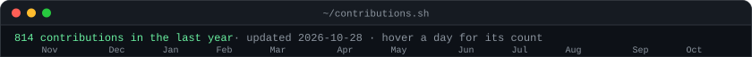
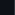
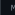
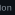
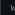
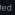
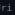
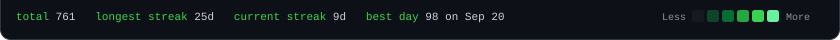

<!-- Generated by scripts/build.py. Edit docs/profile.json instead; this file is rewritten on every build. -->

<table>
  <tr>
    <td valign="top"></td>
    <td valign="top"></td>
  </tr>
</table>
<h6></h6>

<table>
  <tr>
    <td valign="top"></td>
    <td valign="top"></td>
  </tr>
</table>

